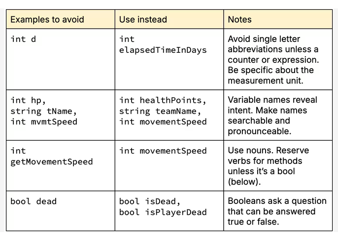

# Standards and Conventions

# Code

## Naming Conventions

- Identifiers for classes, methods, namespaces, interfaces, enums, properties, attributes and co-routines are `PascalCase`(EveryFirstLetterCapitalized):

```csharp
public class MyClass
public string StringToBold(this string inputString)
public float DefaultSpacing
{
	...
}
```

- **(Local variables** are defined within a function or block and exist only for the duration of that execution, whereas **private variables** (in object-oriented programming) are class-level fields accessible only within the defining class but persist for the object's lifetime)
- **Local** variables use `camelCase`(firstLetterLowerCaseRestCapitalized)

```csharp
private void MyFunction()
{
	int localVariable = 1;
	...
}
```

- **Private** variables use `_camelCase`. The _ signals that it is private
    
    ```csharp
    private int _health;
    private InputHandler _inputHandler;
    ```
    
- Public variables use `PascalCase`

```csharp
public int MaxHealth = 100
public str MyString = "I love chairs!"
```

- Constants are written in `UPPER_CASE` :

```csharp
public const int MAX_HEALTH = 100;
```

- Acronyms are treated as words and are written in `PascalCase`:

```csharp
public class XmlFormatter
private class AiBehaviour
```

- Interfaces should include the prefix “I”

```csharp
interface IDamageable
interface IInteractable
interface IUiElement
```

- Method identifiers should describe the effect caused by the method, or the return value if the method has no effect.
- Use **camelCase** for **method parameters**

```csharp
// A method that performs movement on the player character
public void Move(Vector3 movement)
{
    ...
}
```

### General Tips:

- **Prefix Booleans with a verb**:
    - isWalking - local
    - _hasJumped - private
    - IsDead - public
- **Use meaningful names and don’t abbreviate** (unless it’s math): It will save you time long-term and most importantly it is important for code to be human readable and understandable for your colleagues
- The subject that **invokes the event** typically does so from a method prefixed with “On,” e.g. “**OnOpeningDoor**” or “**OnDoorOpened**.”



## Commenting

- Write **useful comments**. **Avoid** being **redundant** with what the code is telling the reader. Instead, disclose valuable information that **might not be directly perceivable**.
- Do not contradict the code
- Use `// TODO: comment` to mark future tasks in the codebase.
    - Very useful for quickly looking through code later with `ctrl+f` search function.
    - Both Rider and Visual Studio allow to quickly look through all TODO’s in your codebase
        - Visual Studio: View → Task List → Comments display keywords TODO
        - Rider: View → Tool Windows → TODO

```csharp
private void Function()
{
	...
	// TODO: figure out how to do this more effectively
}

```

- Ideally every method should have a comment explaining what it does. Even better what are the parameters and what the function returns
- In Rider you can generate these by typing `///` above a method definition.

```csharp
/// <summary>
/// Checks whether a circle at the given position overlaps any collider on the given layer.
/// </summary>
/// <param name="position">World-space center of the check.</param>
/// <param name="radius">Radius of the check circle, in world units.</param>
/// <param name="layerMask">Only colliders on these layers are considered.</param>
/// <returns>
/// <c>true</c> if at least one collider overlaps the circle; otherwise <c>false</c>.
/// </returns>
private bool Collision(Vector2 position, float radius, LayerMask layerMask)
{
    return Physics2D.OverlapCircle(position, radius, layerMask);
}

```

## Code Formatting

- use spaces, not tabs
- each brace should have its own line

```csharp
// Avoid
if (playerWasHit) {
    PlaySound(playerHitSound);
    Damage(player, damageAmount);
}

// Prefer
if (playerWasHit)
{
    PlaySound(playerHitSound);
    Damage(player, damageAmount);
}

// Bad
public float Health { get { return _health; } }

// Good
public float Health
{
    get
    {
        return _health;
    }
}
```

- Every statement after a conditional should be in braces, even if it is a single statement

```csharp
// Bad
if (enemyInRange)
    Explode();

// Good
if (enemyInRange)
{
    Explode();
}
```

### Strings

- For string formatting use **string interpolation**

```csharp
// Avoid
Debug.Log("Player " + playerId + " took a hit from " + damageSource + " for " + damageAmount + " damage.");

// Avoid
Debug.LogFormat("Player {0} took a hit from {1} for {2} damage.", playerId, damageSource, damageAmount);

// Prefer
Debug.Log($"Player {playerId} took a hit from {damageSource} for {damageAmount} damage.");
```

### Get/set methods for single-statement properties

- **expression body definition operator `=>`** can be used for property getters and setters for simple, single-statement properties
- in this case, using the **public Health** property, we can get or set the **private _health** field for the player

```csharp
private float _health;

public float Health
{
    get => _health;
    set => _health = value;
}
_________________________________________________________________________
//usage:
player.Health = 50f;        // calls the setter, value = 50f
float hp = player.Health;   // calls the getter
```

### Switch case

- the switch-case code should be in braces

```csharp
switch (expression) 
{
  case x:
    // {} code block
    break;
  case y:
    // {} code block
    break;
  default:
    // {} code block
    break;
}
```

## General / Unity specific Tips

- Use `[SerializeField] private` instead of public fields for Inspector values.
- **No magic numbers** (use constants or serialized fields)
- Use `CompareTag` rather than `tag ==` . It is more efficient

## Code File Layout

- Put every class definition inside an appropriate namespace;
- Prefer defining **only one class per file**;
- **File name** should be the **same as the class name**.

```csharp
// File: AiPathfinder.cs     //filename
using System.Collections.Generic;
using UnityEngine;

using WaypointMap = Dictionary<Vector3,Waypoint>;

namespace MyGame.AiNavigation
{
    public class AiPathfinder //classname
    {
        ...
    }
}
```

- Usings should be defined in the following order:
    1. System or .NET libraries
    2. Unity libraries
    3. Third-Party plugins (asset store)
    4. Your own utility libraries
    5. Project namespaces
    6. Type name aliases

- All namespace categories should be blocked together, without separating with spaces or comments.
- An exception to this is *typedef*like usings, which should be separated from library usings with an empty line.
- Define a class in the following order:
    1. Nested classes
    2. Constants
    3. Enums
    4. Properties
    5. Fields
    6. Constructors (if applicable)
    7. Unity Messages
    8. Public methods
    9. Private methods

```csharp
public class MyClass : MonoBehaviour
{
    private class MyNestedClass
    {
        ...
    }

    private const int SOME_CONSTANT = 1;

    public enum SomeEnum
    {
        FirstElement,
        SecondElement
    }

    public int SomeProperty
    {
        get => _someField;
    }

    private int _someField;

    private void Start()
    {
        ...
    }

    public void SomePublicMethod()
    {
        ...
    }

    private void SomePrivateMethod()
    {
        ...
    }
}
```

- Prefer defining methods in the following order:
    1. Initialization methods
    2. Core functionality methods
    3. Helper or explanatory methods

```csharp
// Initialization
private void Initialize()
{
    ...
}

// Core functionality
private void Move(Vector3 direction)
{
    ...
}

// Helper
private bool CheckIfPositionIsWalkable(Vector3 position)
{
    ...
}
```

# File Structure

This might change and evolve slightly, but it is important for us to have a folder structure and file naming convention we all agree on, so we can easily navigate the project and find files based on where you **expect** them to be instead of where you **know** they are.

- Prefix the names of files: T_Texture, M_Material, MUS_Song
    - Don’t do this for Scripts and Scenes. They stay CamelCase without prefix
- **No spaces** in any file names. Unity’s command line tools and git have issues with path names that include spaces. If you want to use a space use a ‘_’ or CamelCase (preferably _ for folder names and CamelCase for files)
- **Avoid extra folders at the root level**. Most things should be under Assets. And even the assets folder should be organized. So try to find where your file would fit in existing folders, and only when there is none, create a new one.
- **Keep your internal assets separate from third-party ones**. If you’re using assets from the Asset Store or other plug-ins, odds are that they have their own project structure. Keep your own assets separate.
- **Sub-Folders** split by **asset** **type**
- **Avoid empty folders**

# Asset Standards

- 1 unit = 1 meter

# Git and Version Control

- **Commits** should be **short and precise** (what changes have been made). Any extra details should go in the commit description
- When committing, **only** **stage files you’ve changed**
- Branches should be created from an up-to-date version of the project to solve a specific issue. Once that issue is done and the branch is successfully merged back into an active branch (most likely Developer). That branch should be deleted.
- **main and Developer** should **only** be **merged** **to using the pull request function** on GitHub. This makes sure we peer-review commits into our important and functional branches.
    - before making a pull request check that:
        - tested in play mode
        - no console errors (at least no new ones :) )
- **main** should have commit only for large **important milestones** like alpha, beta, release. They should also be **squash-commits** to keep the commit tree on the main branch nice and clean.
- .**meta files**, unlike most automatically generated files **should** be included in commits. They hold important data like object history etc.

# Further things to add to this document

- version naming
- Bug report template
- Playtest template? (probably better separate)
- quick reference at the top. What do you keep coming back to here to look
- .editorconfig explanation
